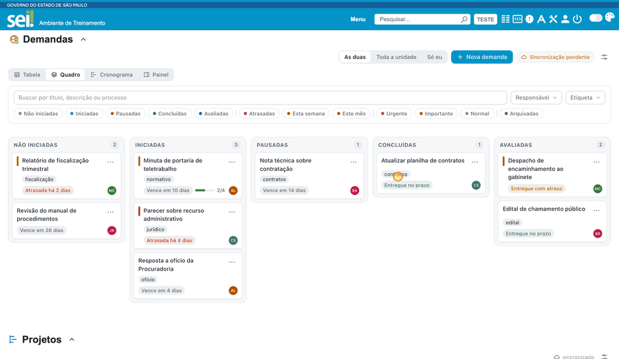
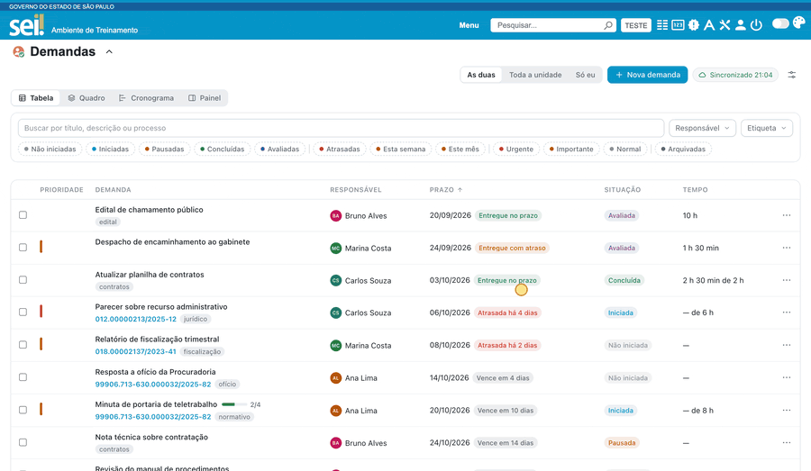
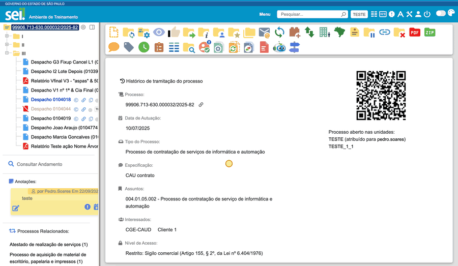
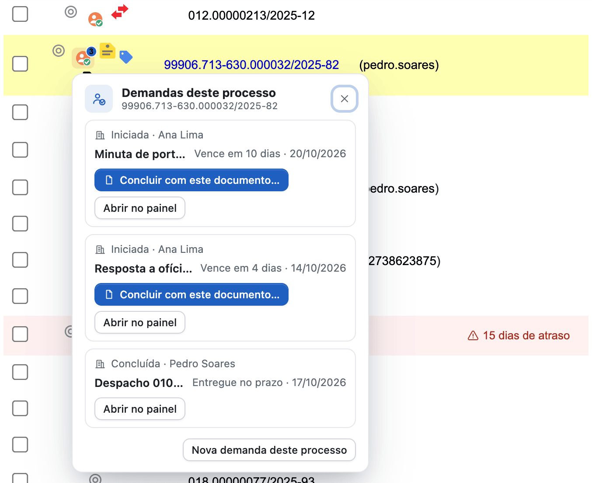

#  |  SEI Pro 

##  Demandas

> Disponível no **Chrome** e no **Edge**; no Firefox ainda não. A função vem **ligada**: veja [Como desligar ou ligar](#como-desligar-ou-ligar).

As Demandas ajudam você e sua equipe a controlar o que precisa ser feito no SEI: cada demanda tem um **título**, um **responsável**, um **prazo** e, se quiser, um ou mais **processos** ligados a ela. Tudo fica dentro do próprio SEI Pro, sem planilha e sem serviço de fora.

### Como desligar ou ligar

As Demandas já vêm ligadas. Para desligar (ou ligar de novo), abra as [Configurações do SEI Pro](../pages/DESATIVARFUNCOES.md), aba **Geral**, seção **Controle de Processos**, e marque ou desmarque **Demandas** (logo abaixo de *Gerenciar Projetos*). Clique em **Salvar** e recarregue a página do SEI. O painel das Demandas aparece abaixo da lista do Controle de Processos, e também na aba **Demandas** do painel lateral do SEI Pro (o mesmo dos [Monitorados](../pages/FAVORITOS.md)), com o número de demandas atrasadas.

> 

Para mudar a posição do painel na página, ou escondê-lo, use a [Ordem e visibilidade dos painéis](../pages/ORDEMPAINEIS.md).

### Criar e atribuir

Clique em **Nova demanda** e preencha o título e o prazo. Escolha o **responsável** na lista (dá para digitar parte do nome para filtrar). Em **Mais campos** ficam a prioridade, a descrição, as etiquetas, o tempo estimado, a lista de tarefas (checklist), os processos ligados e **quem vê** a demanda:

> 

* **Toda a unidade:** os colegas da sua unidade que usam o SEI Pro (versão 2.9 ou mais nova, no Chrome ou no Edge, com as Demandas ligadas) veem e podem editar a demanda.
* **Só eu:** a demanda é só sua.

A demanda também pode apontar para uma etapa do [gerenciador de Projetos](../pages/PROJETOS.md). Cada mudança fica no **histórico** da demanda.

### O ciclo da demanda

Uma demanda passa por **não iniciada**, **iniciada**, **pausada**, **concluída** e **avaliada**. Ao concluir, você registra a data, o tempo gasto e o **documento entregue**. Dá também para **prorrogar** o prazo (o SEI Pro pede o motivo), **avaliar** com uma nota de 1 a 5 e **arquivar** o que já terminou.

### As quatro visões

* **Tabela:** a lista completa, com filtros e ordenação.
* **Quadro:** cartões em colunas, para arrastar de uma situação para outra (também pelo teclado).
* **Cronograma:** as demandas em barras no tempo, agrupadas por responsável ou por situação. Arrastar uma barra muda as datas (mudar o prazo pede um motivo).
* **Painel:** números e gráficos: a situação geral, as atrasadas, a carga de cada responsável, as entregas por mês (no prazo e fora dele), o tempo estimado contra o gasto e a nota média.

Os filtros do alto (situação, prazo, prioridade, responsável, etiqueta e a busca) valem para todas as visões.

> 

### O botão "Demandas" na barra do processo

Com um processo aberto, aparece o botão **Demandas** na barra de ações, com um número quando o processo já tem demandas. Ele mostra as demandas ligadas àquele processo e deixa criar uma nova ali mesmo, em **Nova demanda deste processo**. O formulário já vem preenchido com o que o SEI mostra na tela:

* o **processo** ligado à demanda;
* o **título**, com o nome do documento que estiver aberto (ou o tipo do processo);
* o **responsável**, que começa sendo você;
* o prazo e a prioridade, que você ajusta.

O botão também permite **iniciar**, **concluir com este documento…** (o documento aberto vira o documento entregue, com o número já preenchido; você confirma a data e, se quiser, informa o tempo gasto e uma observação) e **abrir a demanda no painel**. Ele usa só o que já está na tela: não faz consultas extras ao SEI e não marca o processo como visualizado.

> 

Num processo sigiloso, o número do processo e o do documento não entram no título sugerido, e o menu avisa disso.

### O ícone na lista do Controle de Processos

No **Controle de Processos**, cada linha cujo processo tenha demandas ganha um pequeno ícone de demanda (com um número azul quando são duas ou mais). Clicar nele abre o mesmo menu do botão da barra, ali ao lado, com as demandas daquele processo e as ações iniciar, concluir e nova demanda. Demandas arquivadas não contam, e o ícone só aparece com a opção **Demandas** ligada.

> 

### Onde os dados ficam

* **Neste navegador:** toda demanda é guardada no seu navegador, com cópias diárias automáticas.
* **Texto Padrão da unidade:** as demandas de *Toda a unidade* ficam em Textos Padrão do SEI (três textos com nomes que começam por `[_SEIPRO_DEM_`), para que os colegas as vejam. Na primeira vez, você confirma com **Entendi**. As suas demandas *Só eu* ficam só no navegador, a não ser que você escolha guardá-las também num texto só seu.
* **Arquivo:** em *Ajustes*, **Exportar arquivo (backup)** salva tudo num arquivo no seu computador, e **Importar arquivo** traz de volta. Esse arquivo é o seu arquivo de segurança.

> **Atenção: não escreva dados sigilosos no título nem na descrição.** Eles ficam no Texto Padrão, e todos da unidade os leem. O **número** de processo ou de documento sigiloso nunca vai para o Texto Padrão nem para o título sugerido (fica só no seu computador e no seu arquivo), mas o que você digitar no título e na descrição vai como está.

### Quanto cabe

Cada Texto Padrão do SEI aceita até **100 KB**. Numa medição com demandas comuns, cabem cerca de **560 demandas por texto**.

* A partir de **80 KB**, o painel mostra um aviso de que o espaço está acabando.
* Em **100 KB**, a criação de novas demandas é bloqueada. Você ainda pode editar, concluir e arquivar.

### Quando aparece a faixa de limite

Se aparecer a faixa avisando que o espaço está acabando, use **Arquivar concluídas antigas** (menu *Ajustes*): você escolhe há quantos dias a demanda foi concluída (30, 60, 90 ou 180) e o SEI Pro mostra quantas serão arquivadas. Nada é apagado: elas saem da lista ativa e passam para as arquivadas.

Se as arquivadas também encherem, use **Exportar arquivo morto e limpar**. O SEI Pro baixa um arquivo com as demandas arquivadas de antes de uma data e, **só depois que você confirmar que guardou o arquivo**, tira essas demandas do Texto Padrão e do seu navegador. Para trazê-las de volta, use **Importar arquivo**. Depois de uma demanda ser excluída desse jeito, o SEI Pro lembra da exclusão por 180 dias (90 dias nas suas demandas *Só eu*): nesse prazo, importar o arquivo **não** a traz de volta. Passado o prazo, ela volta normalmente.

### Limitações

* **A lista de responsáveis é parcial.** Ela mostra quem já apareceu na caixa de processos, em alguma demanda, ou o nome que você digitar. O SEI Pro não busca a lista completa da unidade para não marcar processos como visualizados.
* **Só no Chrome e no Edge.** Ainda não há no Firefox.
* **Sem e-mail:** a função não avisa ninguém por e-mail.
* **Sem recorrência:** não há demanda que se repete sozinha. Para repetir, use **Duplicar**.

## Próximo item

> [Voltar ao início](../)
