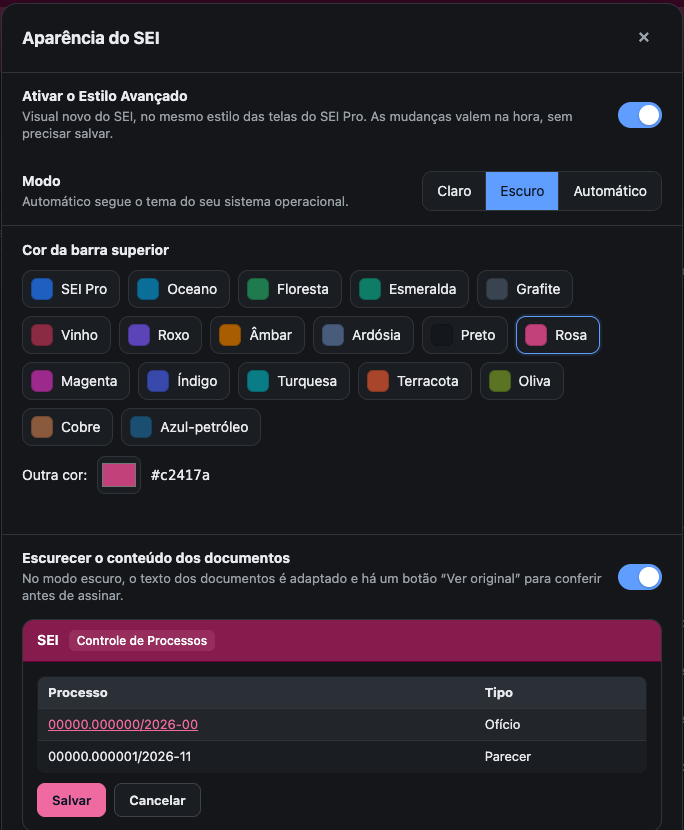

#  |  SEI Pro 

##  Alterar o layout do SEI (Estilo Avançado e Modo Noturno)

Dê ao SEI a **sua cara**: escolha a **cor da barra superior**, use o **modo escuro** (que vale também para o texto dos documentos) e deixe todas as telas do sistema no mesmo visual moderno das telas do SEI Pro.

> O **novo Estilo Avançado** está no **SEI Pro Lab** (Chrome e Edge). Nos demais pacotes continua o estilo anterior, descrito mais abaixo em [Estilo anterior](#estilo-anterior-nos-demais-pacotes).

> 

### Como ligar

O Estilo Avançado **vem desligado**. No canto superior direito do SEI, ao lado dos ícones do sistema, ficam dois controles:

* uma **chave** — liga e desliga o Estilo Avançado. Desligado, o SEI volta ao visual original;
* um ícone de **paleta** — abre a janela **Aparência do SEI**, com todas as opções.

As mesmas opções estão nas **Configurações do SEI Pro**, na seção **Aparência**, e as duas telas ficam sincronizadas: o que você muda numa aparece na outra e nas abas do SEI abertas, na hora, sem salvar nem recarregar. A escolha acompanha o seu navegador entre computadores.

> Ao **ligar** o Estilo Avançado, o [Novo Controle de Processos](../pages/GRADECONTROLE.md) também é ligado (e, se você estiver no Controle de Processos, a grade abre na hora). Depois, se quiser a lista do SEI de volta, é só clicar no botão ao lado do título; o Estilo Avançado não religa a grade sozinho.

### A janela Aparência do SEI

| Opção | O que faz |
| ----- | --------- |
| **Ativar o Estilo Avançado** | Liga e desliga o visual novo |
| **Modo** | **Claro**, **Escuro** ou **Automático** (segue o tema do seu sistema operacional) |
| **Cor da barra superior** | 18 cores prontas (SEI Pro, Oceano, Floresta, Esmeralda, Grafite, Vinho, Roxo, Âmbar, Ardósia, Preto, Rosa, Magenta, Índigo, Turquesa, Terracota, Oliva, Cobre e Azul-petróleo) ou **Outra cor**, a que você quiser. Se a cor escolhida deixar o texto difícil de ler, o SEI Pro ajusta o tom e avisa |
| **Escurecer o conteúdo dos documentos** | No modo escuro, o texto dos documentos é adaptado para não ofuscar. Um botão **Ver original** mostra o documento com as cores originais, como será assinado |
| **Restaurar padrão** | Volta modo e cores ao começo (mantém ligado ou desligado) |

A **prévia** na própria janela mostra a barra, uma tabela e os botões com as cores que você escolheu.

### O que muda no SEI

* **Barra superior** com a cor escolhida, mais alta no topo da página e **compacta ao rolar**. Quando compacta, a faixa com o nome do órgão some e o nome passa a aparecer **ao lado da logo do SEI**.
* **Menu lateral, tabelas, campos, botões e janelas** no visual dos painéis do SEI Pro, com cantos arredondados, hover e foco bem marcados.
* **Barra de ações**: os ícones nativos do SEI continuam como sempre. Os botões do SEI Pro (monitorar, ferramentas de PDF, ação e documentos em lote, comparar documentos, histórico de processos visitados e certidão) ganharam desenho próprio, colorido como os nativos. A barra **fixa no topo** gruda logo abaixo da barra superior.
* **Árvore do processo**: divisor vertical com alça (arraste para mudar a largura), selo da unidade em pílula, divisores de seção suaves e o **menu suspenso** dos documentos sem quebra de texto.
* **Documentos**: uma caixa só, no formato de página. No canto de cima ficam **Largura total** (alterna entre a página estreita e a largura inteira da tela; o navegador lembra), **Abrir documento em nova aba**, **Baixar HTML** e **Baixar DOCX**. Ao rolar o documento, os botões ficam só com o ícone, à direita.
* **Painéis** (Controle de Processos, Monitorados, Projetos, Demandas, Histórico): seguem o modo claro ou escuro escolhido.
* **Dicas** (tooltips) dos botões no mesmo visual do SEI Pro.

### Bom saber

* O Estilo Avançado só muda a **tela**. Os documentos não são alterados: a cor adaptada do modo escuro nunca vai para o que você grava, e o **editor de documentos** não é adaptado.
* Onde o novo Estilo Avançado existe, o **estilo anterior fica desativado**.
* Depois de rolar o documento, o botão de largura e os de baixar ficam só com o ícone; passe o mouse para ver o nome.

---

### Estilo anterior (nos demais pacotes)

#### Como ativar o estilo anterior

No canto superior direito do SEI, ao lado dos ícones do sistema, aparecem dois controles do SEI Pro:

* uma **chave** — clique para **ligar ou desligar** o Estilo Avançado;
* um ícone de **paleta** — clique para abrir as **opções de estilo**.

#### As opções do estilo anterior

| Opção | O que faz |
| ----- | --------- |
| **Cor Principal do Layout** | Escolha uma das cores prontas para o cabeçalho, botões e destaques |
| **Cor personalizada** | Escolha qualquer outra cor |
| **Modo noturno** | Fundo escuro e letras claras, para ambientes com pouca luz |
| **Ícones com legenda** | Mostra o nome de cada botão abaixo do ícone — ótimo para quem ainda está aprendendo o SEI |
| **Barra de Botões na Vertical** | Coloca os botões do processo numa coluna ao lado, liberando espaço em telas largas |

Com o Estilo Avançado ligado, um ícone de **lua/casa** no cabeçalho permite **ligar e desligar o modo noturno** com um clique.

#### No editor de documentos

O editor também tem um botão **Ativar estilo avançado**, que aplica o visual moderno à barra de ferramentas e à área de edição.

#### Bom saber

* O estilo é **pessoal** e fica guardado **neste navegador**: não muda nada para os outros usuários, nem nos documentos.
* O modo noturno muda só a tela. Documentos impressos e PDFs continuam com fundo branco.
* Com o Estilo Avançado ligado, a divisória entre a árvore e o documento pode ser **arrastada** para ajustar a largura — veja [Redimensionar a árvore](../pages/RESIZEARVORE.md).

## Próximo item

> [Menu Suspenso](../pages/MENUSUSPENSO.md)
