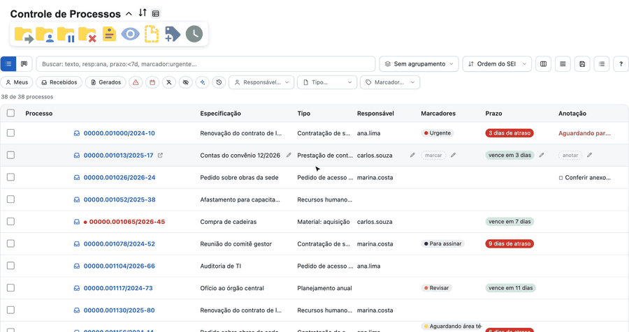
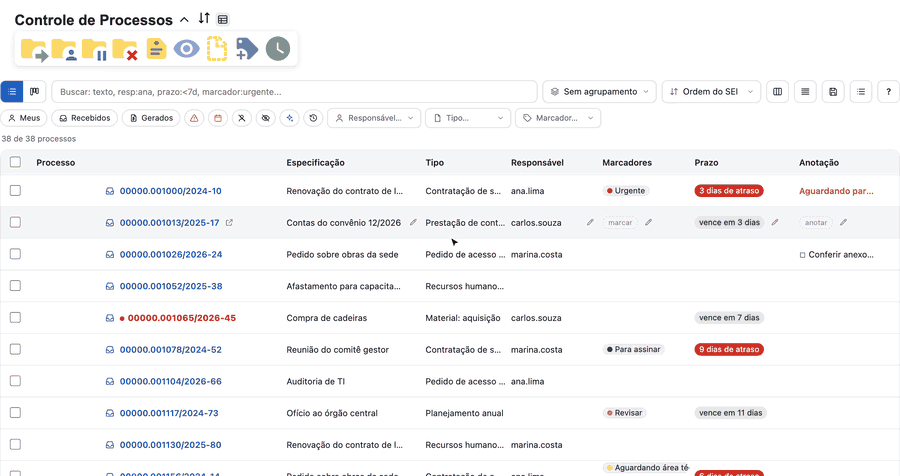
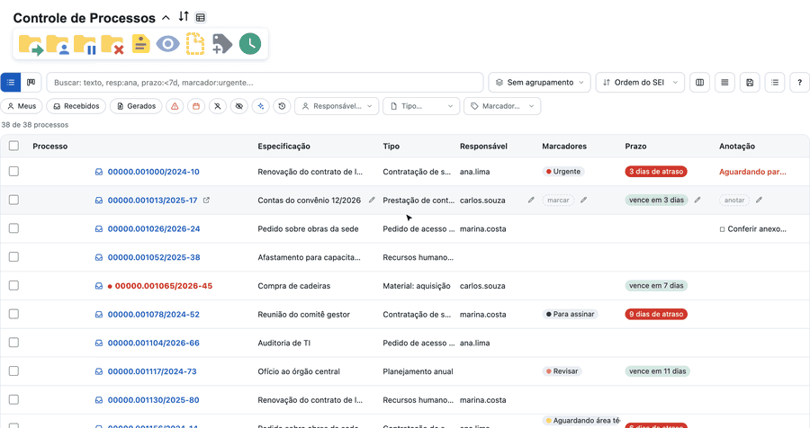

#  |  SEI Pro 

##  Novo Controle de Processos

Uma **grade moderna no lugar da lista do SEI**: você busca com operadores, filtra com um clique, agrupa, ordena, vê os processos em quadro (Kanban) e **edita direto na linha** a especificação, o responsável, os marcadores, o prazo e a anotação. Ela carrega **todos os seus processos** (de todas as páginas do SEI) e abre **sem piscar a tela**.

> O Novo Controle de Processos está disponível no **Chrome** e no **Edge** e a opção vem **ligada** por padrão, mas a grade só aparece quando você **clica no botão** ao lado do título. A lista do SEI continua sendo a tela inicial e o botão alterna entre as duas a qualquer momento.

> 

### Como ativar

A opção já vem **ligada**, e o Controle de Processos continua abrindo na lista do SEI. Para usar o Novo Controle de Processos, clique no botão (sem rótulo) **ao lado do título**; o navegador lembra a sua escolha nas próximas aberturas. Para tirar o botão (ou trazê-lo de volta), abra as [Configurações do SEI Pro](../pages/DESATIVARFUNCOES.md), aba **Geral**, e use a opção **Novo Controle de Processos**, logo antes de *Controlar Prazos*.

Esse botão, **ao lado da seta de recolher** no título, alterna entre o Novo Controle de Processos e a lista do SEI (passe o mouse para ver o que ele faz). A seta de **recolher e expandir** o painel também funciona com o Novo Controle de Processos.

### Buscar e filtrar

Digite na caixa de busca. Texto solto procura no número, no tipo, na especificação, no responsável, nos marcadores e na anotação, sem diferenciar acentos nem maiúsculas. Para ir mais fundo, use **operadores** — todos juntos valem como "E":

| Operador | O que faz | Exemplo |
| -------- | --------- | ------- |
| `resp:` | Responsável (sigla ou nome). `resp:eu` são os seus; `resp:sem`, os sem responsável | `resp:ana` |
| `tipo:` | Tipo do processo | `tipo:"contratação"` |
| `marcador:` | Marcador (nome ou texto). `marcador:sem` são os sem marcador | `marcador:urgente` |
| `espec:` | Especificação | `espec:limpeza` |
| `anot:` | Anotação. `anot:sem`, `anot:com`, `anot:prioridade` | `anot:prioridade` |
| `prazo:` | `atrasado`, `hoje`, `semana`, `sem`, `concluido`, `<7d` (vence em menos de 7 dias), `>30d` | `prazo:<7d` |
| `caixa:` | Há quanto tempo o SEI Pro viu o processo na unidade | `caixa:>30d` |
| `parado:` | Dias desde a última movimentação (visão detalhada do SEI) | `parado:>30d` |
| `novo:` | `sim` (não visualizados) ou `visita` (chegaram depois da sua última visita) | `novo:visita` |
| `grupo:` | `recebidos` ou `gerados` | `grupo:gerados` |
| `retorno:` | `atrasado`, `aguardando`, `programado`, `sem` | `retorno:atrasado` |
| `sigilo:` | `sim` ou `nao` | `sigilo:sim` |
| `-` na frente | Nega o termo | `-resp:ana` |

Use aspas para frases (`"oficio circular"`). Cada termo vira uma **etiqueta** abaixo da busca: clique no **×** para tirá-lo.

Abaixo da busca ficam os **filtros rápidos**: **Meus**, **Recebidos**, **Gerados**, **Atrasados**, **Vencem na semana**, **Sem responsável**, **Não visualizados**, **Novos desde a última visita** e **Parados há +30 dias** (Recebidos e Gerados não aparecem na visão detalhada do SEI, que não os distingue). Em janelas estreitas os filtros viram só ícone — o nome aparece ao passar o mouse. Ao lado, seletores pesquisáveis de **Responsável**, **Tipo** e **Marcador** mostram quantos processos cada opção tem.

### Agrupar, ordenar e organizar

* **Agrupar por** responsável, tipo de processo, marcador, faixa de prazo, visualização (novos/lidos), recebidos e gerados, anotação, acompanhamento especial, retorno programado ou tempo na caixa. Os grupos são **recolhíveis** e têm contagem. Um processo com dois marcadores aparece nos dois grupos de marcador.
* **Ordenar** pelo seletor ou clicando no cabeçalho da coluna (clique de novo para inverter; **Shift** acrescenta um segundo critério).
* **Colunas** (botão de colunas): escolha quais aparecem — Processo, Especificação, Tipo, Responsável, Marcadores, Prazo, Anotação, Na caixa, Parado há e Sinais.
* **Densidade**: linhas compactas ou confortáveis.
* **Visões salvas** (botão de disquete): guarde a busca, o agrupamento, a ordem e as colunas com um nome e troque de visão em um clique. As visões ficam na sua conta do navegador e acompanham você em outros computadores.
* **Exportar CSV**: baixa a visão atual (já filtrada e ordenada) numa planilha pronta para o Excel.

A coluna **Na caixa** conta desde a **primeira vez que o SEI Pro viu o processo** na sua unidade, porque o SEI não informa a data de chegada.

### Quadro (Kanban)

O botão **Quadro** troca a lista por colunas. Divida o quadro por **marcador** ou por **responsável** e **arraste o processo** de uma coluna para outra: o marcador (ou a atribuição) muda no SEI. Aparece um aviso com **Desfazer**. Dá para limitar quantos cartões cabem em cada coluna (a coluna cheia fica destacada) e separar o quadro em **raias por responsável**. Divisões por prazo e por tipo são só para ver.

> 

### Editar na própria linha

Passe o mouse sobre a célula e clique no **lápis**:

* **Especificação** — edita ali mesmo; **Enter** salva e **Esc** cancela.
* **Responsável** — abre uma janela com busca na lista de usuários da unidade, inclusive "Sem responsável".
* **Marcadores** — adiciona, tira e muda o texto de cada marcador.
* **Prazo** — abre a mesma janela do [Controle de Prazos](../pages/PRAZOS.md).
* **Anotação** — abre o post-it (veja abaixo).

Responsável e marcadores têm a opção **Aplicar também aos selecionados**: a mudança vale para todos os processos marcados. Se o SEI recusar uma gravação, a tela volta ao que era e um aviso explica.

> 

#### Anotação em post-it, com lista de tarefas

A janela da anotação usa o mesmo post-it da [anotação pela árvore do processo](../pages/NOTAARVORE.md). Linhas que começam com `[ ]` ou `[X]` são **tarefas**: clique na caixa para marcar (o texto fica riscado), use o botão de **lista de tarefas** para transformar as linhas selecionadas, o botão de calendário para inserir a data de hoje e o de **prioridade** para deixar o post-it vermelho. O limite do SEI, de 500 caracteres, aparece no contador. O texto continua legível no SEI e na anotação da árvore do processo.

> 

### Ações do SEI em vários processos

Marque as caixas (a do cabeçalho marca todos os visíveis) e uma barra de ações aparece com **os mesmos botões da barra do SEI** — Enviar, Atribuir, Concluir, Marcador, Prazo e os demais. Funcionam como sempre, **inclusive para processos de outras páginas do SEI**. Por regra do próprio SEI, uma ação aceita, de uma vez, processos de **uma página por grupo**: marcar processos de duas páginas diferentes de Recebidos mostra um aviso explicando quais.

> 

### Ícones e sinais na linha

Antes do número do processo ficam os ícones que o SEI Pro já tinha: **Monitorado**, **Projetos**, **Demandas** e **Acompanhamento especial** — com o mesmo clique de sempre. Mais um ícone indica se o processo é **recebido** ou **gerado**, e um outro, depois do número, **abre o processo em nova guia**. Processos **não visualizados** ficam em **vermelho**, **urgentes** e **trancados** ganham uma etiqueta e **sigilosos** mostram o aviso (o SEI não entrega a especificação nem os marcadores deles, e o Novo Controle de Processos também não).

### Atalhos de teclado

| Tecla | Faz |
| ----- | --- |
| `/` | Vai para a busca |
| `j` / `k` | Linha seguinte / anterior |
| `x` | Marca a linha |
| `Enter` | Abre o processo |
| `g` `t` / `g` `q` | Tabela / Quadro |
| `Esc` | Limpa a busca ou a seleção |
| `?` | Mostra a ajuda de atalhos |

### Bom saber

* O Novo Controle de Processos **lê** a tabela do próprio SEI e a deixa escondida: nada é reescrito nela. Se algo der errado ao montar a grade, a lista do SEI volta sozinha.
* Funciona na **visão resumida** e na **detalhada** do SEI (na detalhada, os filtros Recebidos e Gerados e o ícone de origem não aparecem), no **SEI 4.1.5** e no **5.0.4**.
* As edições, o quadro e as ações em lote **gravam de verdade no SEI**, como se você fizesse pela tela do SEI.
* O Novo Controle de Processos substitui o agrupamento, o filtro e o quadro da lista antiga (veja [Agrupar, filtrar e ver os processos em quadro](../pages/AGRUPAR.md)); com a opção desligada, tudo continua como antes.
* Não faz nenhuma consulta fora do seu SEI.

## Próximo item

> [Anotações no Controle de Processos](../pages/ANOTACAOCONTROLE.md)
