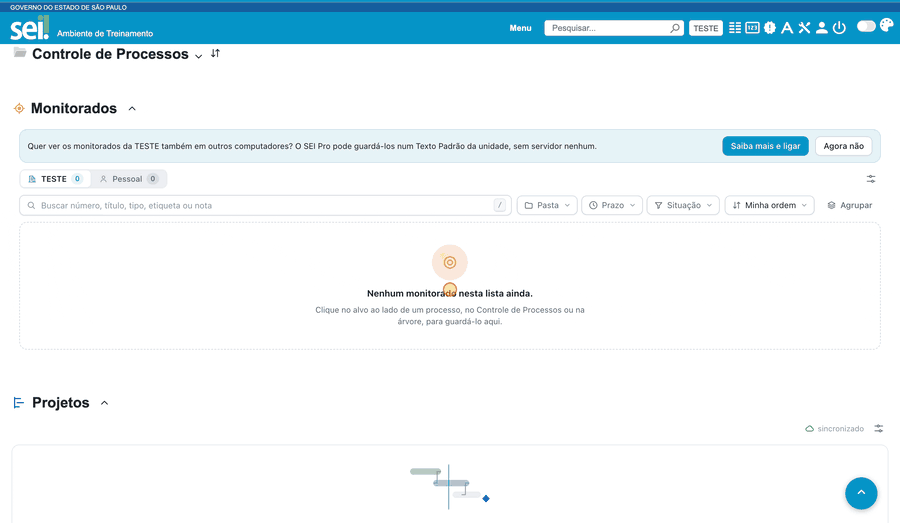

#  |  SEI Pro 

##  Ordem e visibilidade dos painéis

Na tela de **Controle de Processos**, o SEI Pro pode mostrar vários painéis além da lista de processos: **[Monitorados](../pages/FAVORITOS.md)**, **Atividades**, **[Projetos](../pages/PROJETOS.md)** e **[Demandas](../pages/DEMANDAS.md)**. Com esta função, **você decide a ordem deles** e **quais ficam visíveis**, sem precisar recarregar a página.

> 

### Como usar

1. Na barra de título do Controle de Processos, clique no botão **Ordenar e ocultar painéis**. Ele só aparece quando há dois ou mais painéis na tela.
2. No modal, **arraste** cada painel pela alça (ou use as **setas** de subir e descer, que também funcionam pelo teclado) até a posição desejada.
3. Para esconder um painel, desmarque **Mostrar**. O painel **Controle de Processos** fica sempre visível, porque é a própria tela.
4. Clique em **Salvar** (ou no **X**, para sair sem mudar nada). A nova ordem já vale na hora. **Restaurar padrão** devolve a ordem original com todos os painéis à mostra.

### Bom saber

* A escolha é **sincronizada** com a sua conta do navegador: vale em todos os SEI que você usa e nos seus outros computadores. Se você mudar em uma aba, as outras abas abertas acompanham.
* Painéis ocultos continuam na lista do modal, para você poder mostrá-los de novo quando quiser.
* Se um painel ainda não está ativo (por exemplo, o módulo de Atividades desligado), a sua posição fica guardada e volta a valer quando ele aparecer.
* Quem já ordenava os painéis arrastando, na versão antiga, **mantém essa ordem** como ponto de partida. O arrastar antigo foi substituído por este modal, que é mais estável: ele não move os painéis na página, então nada recarrega ao reordenar.
* Disponível no **Chrome** e no **Edge**; no Firefox ainda não.

## Próximo item

> [Gerenciar processos monitorados](../pages/FAVORITOS.md)
