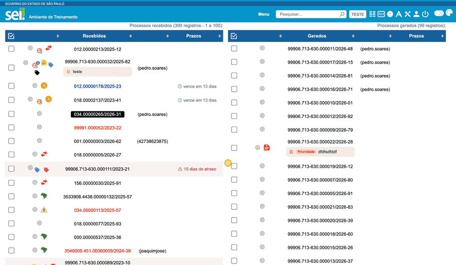

#  |  SEI Pro 

##  Filtrar a página pelo campo de pesquisa rápida

> Disponível no **Chrome** e no **Edge**; no Firefox ainda não.

Com esta opção ligada, você digita no campo **Pesquisar** do topo do SEI, **sem apertar Enter**, e a página responde na hora:

* **No Controle de Processos**, a lista mostra só os processos que correspondem ao que você digitou: número, especificação, tipo, atribuição, prazo, marcador ou anotação já carregados, inclusive as informações que aparecem nas dicas dos ícones.
* **Na árvore e no documento HTML aberto**, as ocorrências ficam **destacadas**. Nenhum documento é escondido. PDF e imagem não recebem destaque.

> 

### Como usar

* O efeito começa com **três caracteres**.
* A comparação ignora maiúsculas, acentos e pontuação: `12345` encontra `12.345`.
* Com várias palavras, todas precisam aparecer no mesmo processo para ele continuar na lista.
* **Enter** mantém a pesquisa normal do SEI.
* **Escape**, ou apagar o texto, restaura a página.

### Como ativar

A função vem **desligada**. Ligue nas [Configurações do SEI Pro](../pages/DESATIVARFUNCOES.md) (opção **Filtrar a página pelo campo de pesquisa rápida**) e clique em **Salvar**. Desligar a opção remove os filtros e os destaques.

### Bom saber

* A busca usa somente o conteúdo **já carregado** na página, sem consultas ao servidor.
* Como o Controle de Processos carrega os processos em páginas, a legenda de cada tabela mostra quantos dos já carregados aparecem (por exemplo, *filtro local: 1 de 100 já carregados*).
* Processos já marcados que o filtro esconde são desmarcados, para que uma ação em lote não atinja o que você não está vendo.

## Próximo item

> [Anotações no Controle de Processos](../pages/ANOTACAOCONTROLE.md)
