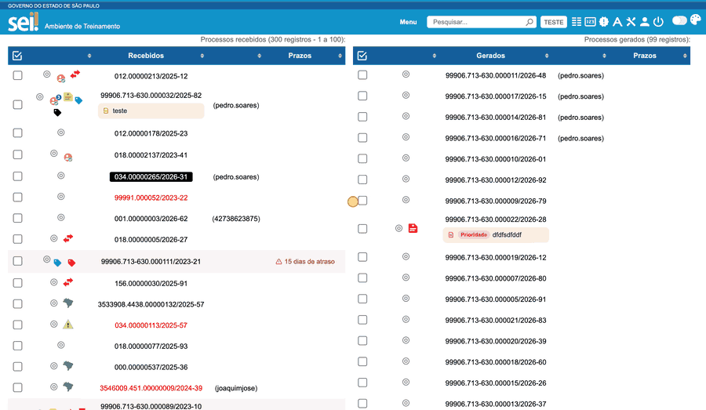
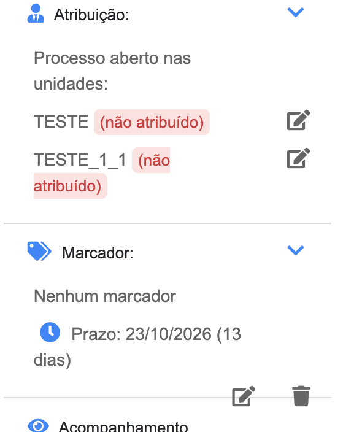

#  |  SEI Pro 

##  Controle de Prazos

Acrescenta à tela **Controle de Processos** uma coluna **Prazos**, que mostra quanto falta para vencer — ou há quanto tempo o processo está parado — em cada processo. Você define o prazo em poucos cliques, para um ou vários processos de uma vez.

> A janela **Prazo** e a gravação no controle de prazo do SEI estão disponíveis no **Chrome** e no **Edge**. No Firefox, o prazo continua gravado no marcador, como antes.

> 

### Como adicionar um prazo

1. Na tela **Controle de Processos**, marque a caixa de seleção de um ou mais processos;
2. Na barra de ações, clique no ícone **Adicionar prazo** (relógio azul);
3. Na janela **Prazo**, preencha:

| Campo | O que informar |
| ----- | -------------- |
| **Controlar vencimento** | Ligado: você informa o **vencimento** e a coluna mostra quanto falta ("vence em 12 dias"). Desligado: você informa uma **data inicial** e a coluna mostra há quanto tempo o processo está parado ("há 5 dias") |
| **Vencimento: Data** ou **Em N dias** | Escolha **Data** para informar o dia do vencimento, ou **Em N dias** para informar quantos dias a partir de hoje, marcando **úteis** se quiser contar só os dias úteis (o SEI desconta os feriados) |
| **Hora** | Opcional. O controle de prazo do SEI só guarda a data; a hora fica no marcador |
| **Marcador** | Opcional. O marcador do SEI em que a hora, o texto ou a data inicial serão gravados |
| **Texto** | Uma descrição curta, opcional — por exemplo, *Responder ofício* |

4. Clique em **Salvar**. A janela diz, enquanto você preenche, onde o prazo será gravado (por exemplo, *Será gravado no controle de prazo do SEI*).

Em alguns segundos a coluna **Prazos** mostra o tempo restante. Clique sobre ele para alterar a data.

Para apagar, abra a mesma janela e clique em **Remover Prazos**.

### Onde o prazo fica gravado

A partir do **SEI 4.1.5**, o vencimento é gravado no **controle de prazo do próprio SEI** (o ícone de relógio da linha do processo e a tela *Controle de Prazos* do menu). Isso tem vantagens:

* **não ocupa o marcador do processo**: você continua usando o marcador para o que ele serve;
* **quem não usa a extensão vê e altera o prazo** pelo próprio SEI;
* o prazo **em dias úteis** é calculado pelo SEI, com os feriados dele;
* dá para **concluir** o prazo (o SEI guarda a data da conclusão) em vez de apagá-lo.

O prazo vai para o **marcador**, como era antes, quando:

* você informa **hora ou texto** (o SEI guarda só a data): o vencimento vai ao controle do SEI, e a hora e o texto ao marcador que você escolher;
* é uma **data inicial** (o SEI só aceita vencimentos);
* a **data já passou** (o SEI recusa datas passadas);
* o seu SEI é anterior ao 4.1.5, ou o seu perfil não tem o controle de prazo.

O texto do marcador tem o formato *"Até 25/09/2026 14:00 Responder ofício"*. Os prazos que já estavam em marcadores continuam aparecendo na coluna.

> **Atenção, para a unidade:** quem ainda usa uma versão antiga do SEI Pro (anterior à 2.9), ou o SEI Pro no Firefox, não vê, na coluna *Prazos*, os prazos gravados só no controle do SEI (o ícone do próprio SEI continua aparecendo). Peça aos colegas para atualizarem a extensão.

### O relógio do próprio SEI

Como o prazo fica no controle do SEI, ele aparece também onde o SEI mostra prazos: o **relógio** na linha do processo e a coluna **Prazos** (*vence em 13 dias*).

> 

### Também dentro do processo

Na árvore do processo, o painel de informações ([Informações adicionais na árvore](../pages/INFOARVORE.md)) mostra o prazo do controle do SEI (*"Prazo: 20/10/2026 (10 dias)"*) junto do marcador, e ao editar o marcador pelo painel os mesmos campos de prazo aparecem.

> 

### Como ativar

A função vem **ligada** de fábrica. Ela fica nas [Configurações do SEI Pro](../pages/DESATIVARFUNCOES.md), aba **Geral**, seção **Controle de Processos**, opção **Controlar Prazos**.

### Bom saber

* Para ver os processos na ordem de vencimento, escolha **Agrupar processos por prazo** em [Agrupar lista de processos](../pages/AGRUPAR.md), ou clique no cabeçalho da coluna **Prazos**.
* A coluna mostra os dias **corridos** até o vencimento. Para contar em dias úteis, escolha **Em N dias** e marque *úteis*.
* Se você digitar à mão uma data no formato `DD/MM/AAAA` no texto de um marcador, o SEI Pro também a reconhece como prazo. Com a palavra **"até"** no texto, ela é tratada como vencimento.
* Para **concluir** um prazo (ele continua listado, sem alerta de atraso) ou **remover**, abra a mesma janela. *Remover* apaga o prazo do controle do SEI e limpa o texto do marcador que o trazia (o marcador continua no processo).
* Depois de gravar, as linhas marcadas são desmarcadas.
* Na janela **Prazo**, os caracteres do **Texto** que o SEI não aceita, comuns em texto colado do Word, são trocados pelo equivalente simples: o travessão (—) vira hífen (-) e as aspas curvas (“ ”) viram aspas retas ("). Os acentos são mantidos.

## Próximo item

> [Reabertura programada de processos](../pages/REABRIRPROCESSOS.md)
