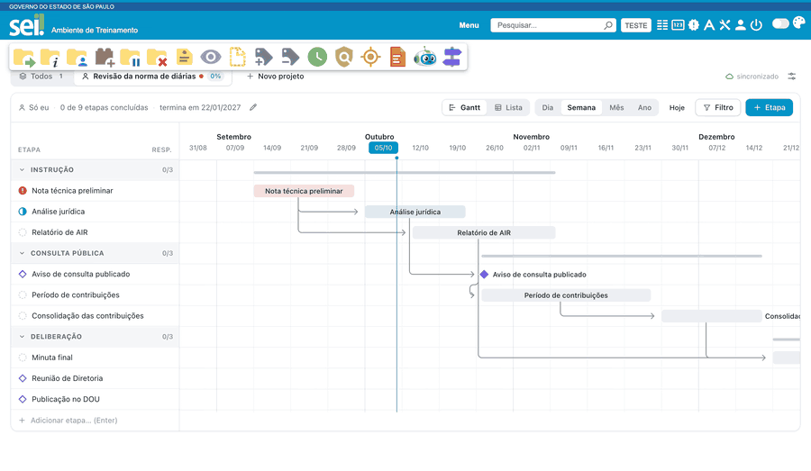

#  |  SEI Pro 

##  Gerenciar projetos

> Disponível no **Chrome** e no **Edge**; no Firefox ainda não. Para ligar, marque **Gerenciar Projetos** nas [Configurações do SEI Pro](../pages/DESATIVARFUNCOES.md), aba **Geral**, seção **Controle de Processos**, salve e recarregue o SEI.

Acompanhe um trabalho do começo ao fim — uma revisão de norma, uma contratação, um plano anual —
dividido em **etapas** com datas, numa linha do tempo (o **Gantt**). Você vê de longe o que está
atrasado, o que vence nesta semana e quanto já foi feito, e resolve o dia a dia com um clique, sem
abrir formulário.

> 

Não precisa de servidor nem de conta: os projetos ficam guardados no seu navegador, e os de **Toda a
unidade** também no próprio SEI, para a sua equipe ver.

### Onde os projetos aparecem

* **Abaixo da lista de processos**, no Controle de Processos: o painel **Projetos**, com uma aba para
  cada projeto e a aba **Todos**, que mostra todos os projetos numa linha do tempo só.
* **No painel lateral**, ao lado de qualquer tela do SEI: aba **Projetos** (junto de Monitorados,
  Histórico e Agente de IA). O número vermelho na aba diz quantas etapas estão atrasadas.
* **Na caixa de processos**: um ícone ao lado do processo que está num projeto.
* **Na tela do processo**: um ícone junto ao número do processo e, quando há etapa atrasada ou que
  vence em até 3 dias úteis, uma faixa logo abaixo.

### Criar um projeto

Clique em **Novo projeto** (no painel lateral, no **+**). Dê um nome, ligue (se quiser) o processo do
SEI — o campo sugere os processos da sua caixa e aceita qualquer número digitado — e escolha **quem vê**:

* **Toda a unidade**: todos da unidade que usam o SEI Pro veem e editam o projeto, que fica no Texto
  Padrão da unidade;
* **Só eu**: só você, nesta unidade.

Dá para mudar depois. Você pode começar **em branco** ou **de um modelo**: o SEI Pro já traz três
(*Revisão normativa*, *Contratação por pregão eletrônico* e *Plano anual*) e você pode salvar os seus
(**Salvar como modelo…**, no menu do projeto; para organizá-los, **Modelos de projeto…**, no menu de
ajustes). A partir de um modelo, basta dizer quando o projeto começa: as datas das etapas saem em dias
úteis.

### Etapas, fases e marcos

* **Etapa**: um passo com início e término (por exemplo, *Nota técnica*). Pode ter responsável,
  checklist, etiquetas, observações e o processo e o documento do SEI ligados a ela.
* **Fase**: um grupo de etapas (por exemplo, *Instrução*), que dá para recolher.
* **Marco**: um momento, sem duração (por exemplo, *Publicação no DOU*). Aparece como um losango.
* **Depende de**: uma etapa só começa depois de outra. Ao arrastar uma etapa no Gantt, as que
  dependem dela vão junto (dá para desligar em **Mover dependentes ao arrastar**, no menu de ajustes).

Para criar uma etapa rápido, escreva o nome na última linha da lista (**Adicionar etapa…**) e tecle
**Enter**. Para mudar datas, arraste a barra no Gantt (nas escalas **Dia** e **Semana**). **Ordenar
etapas**, no menu de ajustes, alterna a ordem da lista: por início, por nome ou por cadastro.

As durações contam **dias úteis**, com os feriados nacionais. A linha de base (um traço fino sob a
barra) guarda o plano original e mostra quanto a etapa foi replanejada; para adotar as datas de hoje
como o novo plano, use **Redefinir plano original**, no menu do projeto.

### O dia a dia: o balão da etapa

Clique numa etapa para abrir o balão. Nele você:

* **conclui** a etapa com um clique (a data é a de hoje; no marco, **Marcar como cumprido**). Logo
  depois aparecem **Informar documento**, para ligar o documento que comprova a conclusão, e
  **Desfazer**;
* acompanha o **progresso** (você informa, ou ele é calculado pelo tempo ou pelo checklist);
* abre o **processo** e o **documento** ligados;
* **edita**, **duplica**, **muda de fase**, vê o **histórico** da etapa ou a **exclui** (com
  **Desfazer**).

### Alertas, filtro e lista

No título do painel aparecem, mesmo com ele recolhido, **"N atrasadas"** e **"N vencem nesta
semana"**. Clique para ver só essas etapas.

O **Filtro** mostra só o que interessa: atrasadas, em andamento, que vencem nesta semana, próximos 30
dias, só as minhas, e por responsável, por fase ou por etiqueta. A vista **Lista** mostra as etapas
numa tabela.

### No painel lateral

A aba **Projetos** do painel lateral é feita para o espaço estreito:

* **Agenda**: o que fazer agora — **Atrasadas**, **Esta semana** e **Próximos 30 dias** —, com
  **Todas** ou **Só as minhas**. Clique num cartão para **Concluir**, **Editar** ou **Ver no
  projeto**.
* **Projetos**: um cartão por projeto, com o progresso. Abra um para ver o **mini-Gantt** (os meses e
  as etapas) e toque numa etapa para o mesmo balão do painel. **Abrir no painel** leva ao Gantt
  completo no Controle de Processos.

O painel lateral segue a aba do SEI que está na frente: ao trocar de unidade no SEI, ele mostra os
projetos da unidade nova. O menu de ajustes dele é mais curto (imprimir e os ajustes do Gantt ficam no
painel do Controle de Processos).

### Na caixa e na tela do processo

* **Na caixa**, o ícone aparece só nos processos que estão num projeto (como processo do projeto ou de
  alguma etapa). Um ponto vermelho avisa que há etapa atrasada. Clique para ver em quais projetos o
  processo está, as etapas e os prazos, e para **Abrir no painel** ou **Adicionar a outro projeto**.
* **Na tela do processo**, o ícone fica junto ao número, mesmo que o processo ainda não esteja em
  projeto nenhum. O balão **Projetos deste processo** tem:
  * **Concluir com documento…**: escolha o documento entre os que já estão na árvore do processo e a
    data, e a etapa é concluída com ele;
  * **Adicionar a um projeto**: como **nova etapa** (o nome sugerido é a especificação ou o tipo do
    processo, começando hoje), **ligado a uma etapa** que já existe, ou como **processo do projeto**;
  * **Abrir no painel**, que abre o painel lateral no projeto.

O projeto precisa existir antes: crie-o no painel ou no painel lateral. O SEI Pro não abre processo
nenhum por conta própria para isso: usa só o que já está na tela.

### "Toda a unidade" e o "Entendi"

Antes da primeira gravação num projeto de **Toda a unidade** — no painel, no painel lateral ou nos
balões da caixa e da tela do processo —, um aviso explica que esses projetos ficam num Texto Padrão
da unidade, que todos da unidade com o SEI Pro leem e gravam, e pede o seu **Entendi**. Sem ele, nada
muda nesses projetos: **Agora não** não grava e deixa o que você digitou como estava. Para um projeto
só seu, escolha **Só eu**.

### Guardar e levar os projetos

Os projetos ficam guardados na extensão (limpar o cache do navegador não os apaga). Em
**Sincronização…**, no menu de ajustes:

* **Texto Padrão da unidade**: os projetos de Toda a unidade ficam num Texto Padrão do SEI chamado
  `[_SEIPRO_PRJ_UNIDADE]`, que todos da unidade com o SEI Pro leem e atualizam. **Sincronizar agora**
  traz e leva na hora.
* **Texto Padrão pessoal**: se quiser ver os seus projetos de Só eu em outro computador, **ligue** o
  texto pessoal (`[_SEIPRO_PRJ_seu.login]`). Dá para **desligar** e para **apagar do SEI** na hora.
* **Arquivo numa pasta da nuvem** (Chrome e Edge): escolha um arquivo numa pasta que já sincroniza
  (OneDrive, Google Drive, Dropbox, rede). Ele leva todos os seus projetos, de todas as unidades. Onde
  o navegador não deixa manter o arquivo ligado, use **Exportar tudo** e **Importar de um arquivo…**
  (importar sempre junta, nunca apaga).
* **Cópias deste navegador**: uma por dia, as 14 mais recentes. **Restaurar** traz de volta o que foi
  excluído ou sumiu desde a cópia; o que existe hoje não muda (a restauração não volta no tempo nem
  desfaz o que um colega editou).

Não use esses textos em documentos nem os edite: o SEI Pro os regrava sozinho (e os tira da lista de
Texto Padrão ao gerar documento).

### Mandar um projeto a outra pessoa

Para mandar um projeto a outra pessoa ou unidade, use **Enviar projeto por arquivo…**, no menu de
ajustes: o SEI Pro baixa um arquivo (o nome termina em `.seipro-projeto.json`) com o projeto, as fases
e as etapas. Do responsável vai só o nome; o histórico não vai; e o processo sigiloso vai sem o
número. Quem recebe usa **Receber projeto de arquivo…** e escolhe onde guardar (Toda a unidade ou Só
eu): entra uma cópia, que não mexe no original de quem enviou.

### Histórico de alterações

**Histórico de alterações**, no menu de ajustes, mostra quem mudou o quê e quando (datas,
responsável, conclusão, fase…), útil nos projetos de toda a unidade.

### Do servidor do Atividades

Quem usa o servidor do Atividades continua vendo o painel antigo, que passa a se chamar **Projetos
(Atividades)**. Para trazer esses projetos para o gestor novo, use **Importar do servidor do
Atividades…** no menu de ajustes (o item só aparece com o servidor configurado). Dá para repetir:
reimportar atualiza o que você não mexeu aqui, e nada se duplica.

### Planilha e PDF

No menu de ajustes: **Exportar planilha (CSV)**, com as etapas do que está na tela (no painel lateral,
de todos os projetos), e **Imprimir / salvar PDF**, com o Gantt e a tabela (só no painel do Controle
de Processos).

### Agente de IA

No painel lateral, peça ao Agente: *"O que está atrasado nos meus projetos?"* ou *"O que vence nesta
semana?"* — no Controle de Processos, a sugestão **O que vence nos projetos** já faz a pergunta. Ele
lê os projetos da sua unidade (sem os de processo sigiloso), não recebe número de processo nenhum e
não muda nada.

### Como ativar

Abra as [Configurações do SEI Pro](../pages/DESATIVARFUNCOES.md), aba **Geral**, seção **Controle de
Processos**, e marque **Gerenciar Projetos** (logo abaixo de *Processos Monitorados*). Clique em **Salvar** e
recarregue a página do SEI. Para mudar a posição do painel ou escondê-lo, use a
[Ordem e visibilidade dos painéis](../pages/ORDEMPAINEIS.md).

### Bom saber

* **Processo sigiloso** pode estar num projeto, mas o número dele nunca vai para o Texto Padrão, para
  a planilha, para o projeto enviado por arquivo nem para o Agente. Fica só com você: neste navegador
  e nas suas próprias cópias (o arquivo da nuvem, o **Exportar tudo** e as cópias diárias). A etapa
  nova de processo sigiloso não ganha nome sugerido.
* Os dias úteis consideram os **feriados nacionais**; feriados locais ficam de fora.
* Um projeto pode ter até 300 etapas, e cada unidade até 100 projetos ativos por lista ("Toda a
  unidade" e "Só eu"). Projetos concluídos podem ser **arquivados** (no menu do projeto) e voltam por
  **Projetos arquivados**, no menu de ajustes.

### Ferramenta antiga (descontinuada)

Antes da versão 2.7, os projetos usavam uma planilha do Google como base de dados. Essa ferramenta foi descontinuada, porque dependia de uma API do Google que foi desativada. As páginas abaixo ficam só como registro: [Base de dados no Google Spreadsheets](../pages/BASEDADOS.md), [Conectar ao Google Spreadsheets](../pages/SEISHEETS.md), [Compartilhar projetos](../pages/PROJETOSSHARE.md), [Carregar chaves de outro usuário](../pages/PROJETOSIMPORT.md) e [Criar e editar projetos](../pages/PROJETOSEDIT.md).

## Próximo item

> [Voltar ao início](../)
