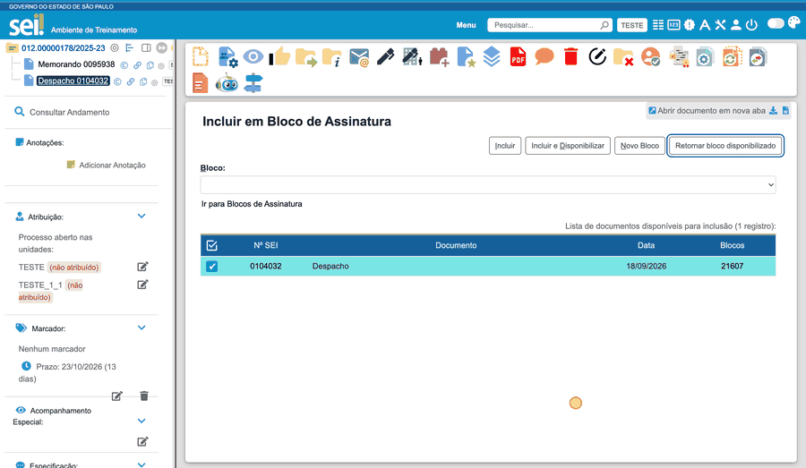

#  |  SEI Pro 

##  Retornar bloco de assinatura disponibilizado

> Disponível no **Chrome** e no **Edge**; no Firefox ainda não.

Na tela **Incluir em Bloco de Assinatura**, o botão **Retornar bloco disponibilizado** permite recolher um bloco para incluir novos documentos, sem sair da tela.

> 

### Como usar

1. Marque os documentos e abra **Incluir em Bloco de Assinatura**.
2. Clique em **Retornar bloco disponibilizado**.
3. Escolha o bloco pelo número e pela descrição.
4. Confirme em **Retornar bloco**.
5. Depois da confirmação pelo SEI, o bloco fica selecionado no campo **Bloco**, e os documentos marcados continuam selecionados.
6. Use **Incluir** ou **Incluir e Disponibilizar**, conforme necessário.

### Bom saber

* O retorno **cancela a disponibilização** para outras unidades. Depois da inclusão, você pode disponibilizar o bloco de novo.
* A lista mostra apenas os blocos disponibilizados para os quais o SEI oferece essa ação à sua unidade. Ela não inclui blocos recebidos que só podem ser devolvidos à unidade geradora.
* Se o SEI recusar a operação, a sessão expirar ou a verificação falhar, a extensão mostra a mensagem sem inserir uma opção fictícia no campo **Bloco**. Confira o estado do bloco no SEI antes de repetir uma operação cuja confirmação falhou.

### Como ativar

Nas [Configurações do SEI Pro](../pages/DESATIVARFUNCOES.md), a opção **Retornar bloco de assinatura disponibilizado na tela de inclusão** liga ou desliga o botão. Ela vem **ligada** e a mudança vale também para telas já abertas.

## Próximo item

> [Voltar ao início](../)
